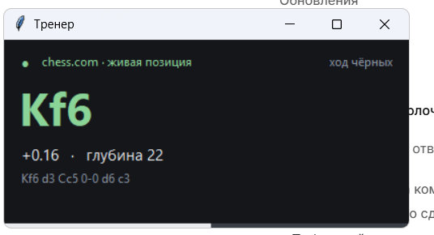

# Шахматный тренер

Локальный шахматный движок **Stockfish** в отдельном окне поверх всех программ: программа читает позицию с доски на **chess.com** (или lichess) и показывает лучший ход, оценку и линию продолжения. На доске рисуется зелёная стрелка.

Всё считается на вашем компьютере: ни запросов наружу, ни аккаунтов, ни подписок.



## Скачать готовую сборку

Windows 10/11 (64 бита), **Python не нужен** — всё внутри архива:

**[⬇ Скачать последний релиз](../../releases/latest)** → `Шахматный-тренер.zip` → распаковать → запустить `ChessCoach.exe`

Пошаговая инструкция для друга лежит в архиве (`ИНСТРУКЦИЯ.txt`) и в файле [ИНСТРУКЦИЯ-ДЛЯ-ДРУГА.txt](ИНСТРУКЦИЯ-ДЛЯ-ДРУГА.txt).

## Как это работает

```
userscript (браузер)  ──POST /api/position──▶  локальный сервер 127.0.0.1:8765
        ▲                                              │
        └────── стрелка лучшего хода на доске ◀─────────┘
                                                       ▼
                                              Stockfish (локально)
                                                       │
                                        окно «Тренер» поверх всех окон
```

* **Позиция** берётся из DOM страницы (элементы `.piece`), а не с экрана — поэтому нет ошибок распознавания картинки.
* **Ориентация доски** определяется по классу `flipped` и подписям полей, с перекрёстной проверкой по пиксельным координатам фигур. Если что-то не так — `Shift` + клик по плашке переворачивает доску.
* **Права на рокировку и поле взятия на проходе** восстанавливаются по разнице между позициями: если новая расстановка получается из предыдущей ровно одним легальным ходом, состояние переносится точно, иначе включается эвристика «король и ладья на своих полях».
* **Анализ** всегда идёт по самой свежей позиции: устаревший поиск прерывается, как только пришёл новый ход.

## Возможности

* лучший ход крупно + оценка (в пешках или «мат в N») + глубина;
* линия продолжения в русской нотации (`Кf3`, `Лe8`, `0-0`);
* полоска преимущества;
* 1–3 линии анализа (MultiPV), скорость 0.15–2 с на ход;
* стрелка лучшего хода прямо на доске, плашка с оценкой;
* диагностическая страница: 4 галочки — сервер, движок, скрипт, доска;
* тестовая доска `/test`, повторяющая разметку chess.com, — проверка распознавания без игры.

## Установка из исходников

```powershell
git clone https://github.com/kuza29/chess-coach.git
cd chess-coach
python -m pip install -r requirements.txt
```

Скачайте Stockfish ([официальные релизы](https://github.com/official-stockfish/Stockfish/releases)) и положите `stockfish.exe` в папку `engine\`, затем:

```powershell
python run.py
```

Откроется страница статуса и окно «Тренер». Скрипт для браузера ставится по ссылке
`http://127.0.0.1:8765/userscript/chess-coach.user.js` (нужен [Tampermonkey](https://www.tampermonkey.net/)).

### Параметры

```powershell
python run.py --movetime 1.0 --multipv 3 --threads 6
python run.py --engine "C:\tools\stockfish.exe"
python run.py --no-gui      # только сервер
python run.py --port 9000
```

## Сборка .exe

```powershell
.\build.ps1
```

Скрипт ставит PyInstaller, собирает `dist\ChessCoach\` и докладывает туда Stockfish, userscript и инструкцию.

## Горячие клавиши

| клавиши | действие |
|---|---|
| `Alt` + `C` | включить/выключить стрелку на доске |
| `Alt` + `D` | диагностика: показать прочитанный FEN |
| `Shift` + клик по плашке | перевернуть ориентацию доски |
| правый клик по окну «Тренер» | скорость анализа, число линий, копировать FEN, выход |

## Структура проекта

| файл | назначение |
|---|---|
| `run.py` | запуск: локальный сервер + окно |
| `chess_coach/server.py` | HTTP-мост и страница статуса |
| `chess_coach/positions.py` | сборка FEN, восстановление прав на рокировку |
| `chess_coach/engine.py` | Stockfish, оценка, русская нотация |
| `chess_coach/panel.py` | окно с лучшим ходом (tkinter) |
| `chess_coach/mock_board.html` | тестовая доска |
| `userscript/chess-coach.user.js` | скрипт для браузера |

## Ограничения

* Позиция читается из DOM: если chess.com сменит разметку, селекторы придётся обновить (диагностика `Alt+D` показывает, что именно прочитано).
* Пока поддерживаются chess.com и lichess; другие сайты — только через тестовую доску.
* Порт `8765` слушается только на `127.0.0.1`, наружу ничего не открыто.

## Честная игра

Помощь движка **в рейтинговых партиях онлайн запрещена** правилами chess.com и lichess — за это блокируют аккаунт. Проект предназначен для тренировочных партий с компьютером, разбора своих партий и учебных позиций.

## Лицензия

MIT — см. [LICENSE](LICENSE).
